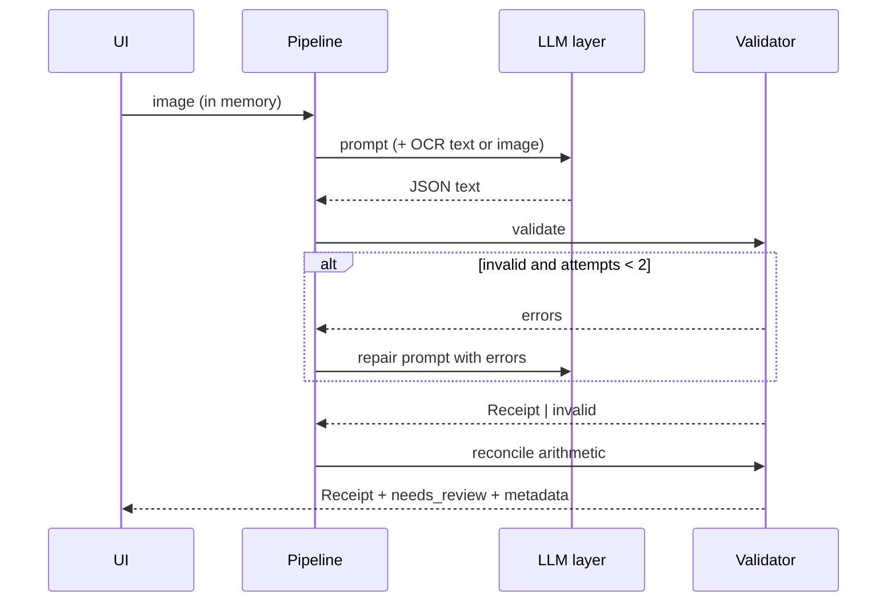
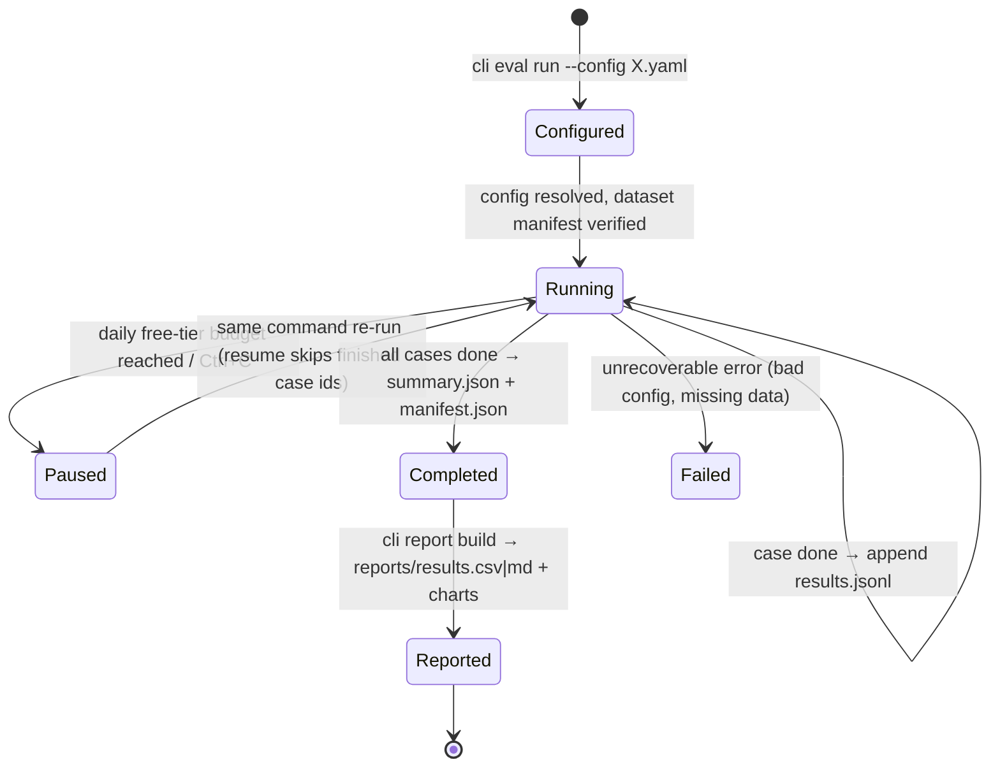
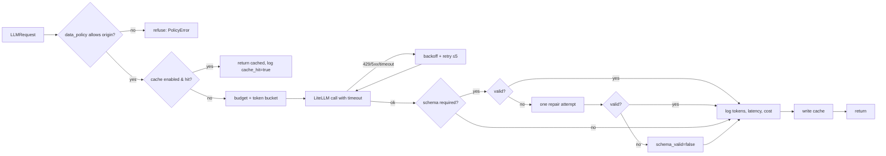

# Application Flow — Receipt-to-JSON Extractor

> A receipt photo goes in; validated JSON (line items, prices, totals) comes out — OCR+LLM vs a vision LLM, compared on accuracy, latency and cost.

Project documentation: [PRD.md](PRD.md) · [TRD.md](TRD.md) · **APPFLOW.md** · [UI_UX_DESIGN.md](UI_UX_DESIGN.md) · [BACKEND_SCHEMA.md](BACKEND_SCHEMA.md) · [IMPLEMENTATION_PLAN.md](IMPLEMENTATION_PLAN.md) · [WORKLOG.md](WORKLOG.md) · [IMPLEMENTATION_PROMPTS.md](IMPLEMENTATION_PROMPTS.md) · [CLAUDE.md](CLAUDE.md) · [PROMPT_PLAYBOOK.md](PROMPT_PLAYBOOK.md)

| Field | Value |
|---|---|
| Project | P01 · `01-receipt-extractor` |
| Type | Quick win 1 of 3 |
| Skill it adds | Multimodal, structured output |
| Target role signal | AI/GenAI Engineer · document AI · structured outputs · evaluation |
| Effort | ≈ 3.75 focused days (sum of task estimates; the ideas doc says 2–3 days) |
| Public artefact | Hugging Face Space (upload a receipt, see both pipelines side by side) |
| Interface | Gradio 6 → Hugging Face Space |
| Status | Specification v2 (lean) · 2026-10-22 |

---

## 1. User journeys

### J1 — Recruiter
Lands on the Space's **Results** tab → sees "Gemini vision: [X] F1 vs OCR+LLM [Y] at [Z]× the cost"
→ opens **Try it**, clicks a sample receipt → both pipelines' JSON side by side with latency, cost and
a green "totals reconcile" badge.

### J2 — Visitor uploads their own receipt
Upload → pipeline A only (uploads never go to Gemini's free tier) → JSON + reconcile badge;
B's column shows "Vision model runs on sample receipts only (privacy)".

### J3 — Developer reproduces
`cli data prepare` → `cli eval run --config configs/runs/a.yaml` (and `a-naive`, `b`) → optional
Kaggle notebook + `cli eval import-predictions` → `cli report build` → `cli report failures`.

## 2. System flow — extraction

Pipeline A (M1.3): the image is decoded in memory → RapidOCR → layout-ordered text placed between
`<ocr_text>` tags as untrusted data → `groq-oss-20b` with the `Receipt` schema. Naive mode
(`A-naive`) stops after the first reply (no repair, no checks); engineered mode (`A`) runs the
repair branch above. No OCR text → no model call (`failure = ocr_empty`).

Pipeline B (M2.1): only `data_origin = public_dataset` is accepted — anything else raises
`DataPolicyError` before the image is decoded, and the `public_only` alias would refuse it again in
the LLM layer. The image is checked (size, format, dimensions from the header), downscaled to
1,536 px on its long side (never upscaled) and re-encoded as JPEG in memory (metadata dropped) →
`gemini-flash-lite` (Gemini 3.5 Flash-Lite) with the `Receipt` schema and the repair branch above (variant `B`). The size sent
and the image's input tokens are recorded.

Variant `C-local` (M2.1, eval only): the same flow against Qwen3-VL-4B-Instruct on the local CPU
via Ollama (`ollama-qwen3-vl-4b`, images ≤ 1,024 px), with the same dataset-only guard.

## 3. States

| State | UI |
|---|---|
| reconciled | green badge "Totals add up" |
| not reconciled | amber "Totals don't add up — needs review" with the difference |
| invalid after retries | red "Couldn't produce valid JSON" + raw model text in the evidence panel |
| budget exhausted | banner, sample receipts show cached results |

Mapping (M2.2): reconciled = `reconciled is true`; not reconciled = `schema_valid` and
`reconciled is false` (show `reconcile_diff`); invalid after retries = `schema_valid is false`
(`needs_review` true, `raw_text` kept). `A-naive` has no state badge (its flags are null).

---

## S1. Evaluation run lifecycle (shared)

Kaggle variants join at `Completed` through `cli eval import-predictions`. Exit codes of
`cli eval run`: 0 completed, 3 paused (budget), 130 interrupted (Ctrl+C), 1 config/data error.

## S2. LLM call flow (shared)

## S3. Results viewing (shared)

1. `cli report build` writes `reports/results.csv` (one row per variant × subset) and `reports/*.png`.
2. The Space's results tab reads those committed files — no live recomputation, no database.
3. The failures tab reads `reports/failures.csv` (hand-labelled `failure_label`, `note`).
