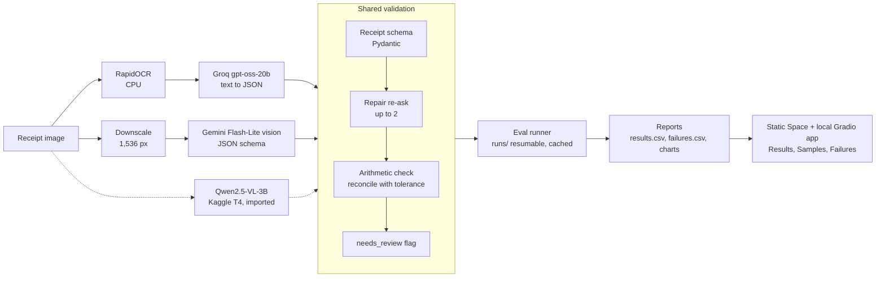

# Receipt-to-JSON Extractor

> A receipt photo goes in; validated JSON (line items, prices, totals) comes out — OCR+LLM vs a vision LLM, compared on accuracy, latency and cost.

> **Headline:** on 100 held-out CORD-v2 receipts, Gemini 3.5 Flash-Lite reading the image reaches
> **0.957 field F1** (84 receipts with every field right), against 0.846 for an OCR + LLM pipeline
> with schema retries (58 receipts) and 0.820 for its naive version (55). The vision model costs
> about 2.5× more per 1k receipts at list price, and the gap is outside the confidence intervals;
> the retries and arithmetic checks mostly fix invalid JSON (6 % → 2 %), not accuracy.

**Demo:** [huggingface.co/spaces/udai30/receipt-extractor](https://huggingface.co/spaces/udai30/receipt-extractor) — the results, six sample receipts with both
pipelines' answers side by side, and every labelled failure.

## Results

<!-- results:start -->
| Pipeline | Model | Field F1 [95% CI] | Valid JSON | Reconciled | p50 / p95 latency | List cost / 1k | Run |
|---|---|---|---|---|---|---|---|
| A-naive | groq-oss-20b | 0.8200 [0.7653, 0.8702] | 0.94 | 0.59 | 2.4 s / 8.4 s | $0.3523 | `A-naive-5ed10911e9ae` |
| A | groq-oss-20b | 0.8464 [0.8014, 0.8894] | 0.98 | 0.63 | 7.1 s / 31.9 s | $0.3930 | `A-e8c045ee22e6` |
| B | gemini-flash-lite | 0.9572 [0.9305, 0.9782] | 1.00 | 0.85 | 4.1 s / 17.0 s | $0.9751 | `B-cea8aeff49d5` |
<!-- results:end -->

_Generated from `reports/` by `uv run receipt_extractor report readme` (test split, 100 receipts,
same ids for every row; latency excludes free-tier pacing)._

<!--  -->
_Demo GIF: to be recorded from [docs/GIF_SCRIPT.md](docs/GIF_SCRIPT.md) and added here._

## Architecture



Pipelines A, B and C all return the same `Receipt` model, so the scorer compares them field by
field. `A-naive` skips the repair and arithmetic steps and stays in every table as the baseline.
Uploads go to pipeline A only; Gemini sees public CORD images only. Details: [TRD.md](TRD.md) §2.

## How it works

All pipelines return the same `Receipt` model (line items with name, quantity and price; subtotal;
tax; total; currency), so one scorer compares them field by field.

- **A, OCR + LLM.** RapidOCR reads the image on the CPU, the text is laid out line by line, and
  Groq `gpt-oss-20b` turns it into JSON under the `Receipt` schema. `A-naive` stops there. `A`
  (engineered) validates the reply with Pydantic, re-asks up to twice with the validation errors
  appended, and then checks the arithmetic (items against subtotal, subtotal plus tax against total,
  with a tolerance) to set `reconciled`, `reconcile_diff` and `needs_review`.
- **B, vision LLM.** The image is downscaled to 1,536 px on the long side, which also strips its
  metadata, and sent to Gemini 3.5 Flash-Lite with the same schema, the same repairs and the same
  checks. B refuses anything but public dataset images before the image is decoded.
- **Money** is `Decimal`. Receipts print amounts like `51.000` (Indonesian thousands), and one tested
  function turns them into numbers, so no pipeline interprets a price its own way.
- **Not in the table:** pipeline C (Qwen2.5-VL-3B on a Kaggle GPU) is prepared as a notebook but
  has not been run; it adds a row when it is imported.

## Evaluation method

- **Data:** the 100 CORD-v2 test receipts, the same ids for every row (a fixed sample seed, checked
  by hashing the id list). Prompts and settings were tuned on the validation split only. The test
  split was first touched when the benchmark runs started, and no prompt or parsing change was made
  after that.
- **Scorer:** items are matched order-insensitively (Hungarian matching on name similarity and
  price; a match needs similarity of at least 0.8 and an equal price). `field_f1` pools the matched
  items and the subtotal, tax and total fields per receipt and averages over receipts. Confidence
  intervals are 95 % bootstrap intervals over receipts. A receipt "passes" only if every field is
  right.
- **Cost** is list price from logged tokens (the runs themselves used free tiers, so actual spend
  was $0). **Latency** is end to end per receipt, excluding time spent queued for free-tier rate
  limits; provider retry backoff stays in. Wall-clock p95 is in `reports/results.md`.
- **Reproducibility:** every number in the tables comes from `report build` and `report readme` and
  traces to a run id. Runs are resumable and model replies are cached.

## What the numbers say

- **Vision beats OCR + LLM on every field.** B is 0.111 field F1 ahead of A, and their intervals do
  not overlap ([0.931, 0.978] against [0.801, 0.889]). The gap is largest on tax (1.00 against
  0.83), items (0.935 against 0.836) and subtotal (0.925 against 0.836); total is 0.99 against 0.89.
  B's output adds up (reconciled) on 85 % of receipts, about the rate of the printed gold receipts
  (84 %), against 63 % for A.
- **The engineering helped validity, not accuracy.** From A-naive to A, valid JSON goes from 0.94 to
  0.98 and field F1 from 0.820 to 0.846, but the intervals overlap almost completely, so at 100
  receipts the accuracy gain cannot be told apart from noise.
- **Where the baseline wins:** A-naive is the cheapest ($0.35 per 1k) and, in the benchmark, the
  fastest (p50 2.4 s, p95 8.4 s). A's higher benchmark latency (p50 7.1 s, p95 31.9 s) includes
  provider retry backoff from a period when Groq's daily quota was nearly spent; I did not isolate
  the cause further.
- **Cost:** about $0.98 per 1k receipts for B at list price, against $0.39 for A.

### One fix, with before and after

Reading A's failures showed that 5 of its 42 had been scored without their repair re-ask. The
repair call had been refused by Groq's daily quota, and the client returned the unrepaired first
reply as the answer instead of pausing the run. This was a bug in my pipeline, not a model
weakness. After the fix, those five cases were re-run (no prompt change):

| A (engineered), 100 test receipts | before | after |
|---|---|---|
| Field F1 [95 % CI] | 0.8274 [0.7741, 0.8768] | 0.8464 [0.8014, 0.8894] |
| Valid JSON | 0.95 | 0.98 |

## Failures by cause

Every failing receipt was labelled by hand against the gold data (and, for A, the OCR text).

<!-- failures:start -->
| Failure cause | A-naive | A | B |
|---|---|---|---|
| ocr_misread | 8 | 11 | 0 |
| wrong_item_split | 7 | 7 | 0 |
| hallucinated_item | 6 | 5 | 6 |
| number_format | 4 | 5 | 0 |
| other | 20 | 14 | 10 |
| **Total** | 45 | 42 | 16 |
<!-- failures:end -->

_Counts come from `reports/failures.csv`; the table is generated by `report readme`._

- **OCR pipelines fail on reading and on item boundaries.** OCR misreads (a total read as `5,000`
  for `54,000`), items split or merged across wrapped lines, and amounts parsed wrongly account for
  23 of A's 42 failures and 19 of A-naive's 45. B has none of these.
- **Every variant reads layout lines as items.** Discount lines, sub-lines and summary rows
  (`ITEMS 1.00`, `** FOOD`) taken as items appear in all three variants, and are 6 of B's 16
  failures.
- **Much of B's remainder is convention, not error:** item codes left in names, a printed subtotal
  not extracted, and gold names that carry their own OCR typos.

## Limitations

- **One dataset and a small test set.** 100 Indonesian receipts from one public dataset. The
  intervals are wide, and the A against A-naive difference is not resolved.
- **Model and modality are confounded.** A and B differ in input (text from OCR, or the image) and
  also in model and provider (`gpt-oss-20b` on Groq, Gemini 3.5 Flash-Lite). The table does not
  separate the two; a fair test would give the same LLM both the OCR text and the image.
- **The gold labels are not perfect.** Only 84 % of the printed gold receipts add up (tax-inclusive
  item prices, rounding), so `reconciled` has a ceiling below 1, and some "errors" are typos in the
  gold names. The review flag can also miss errors that are consistent but wrong.
- **Free tiers shape the results.** Groq's daily token window and Gemini's free-tier terms (which may
  use submitted data) decided how the runs were scheduled, and why uploads go to A only and never to
  Gemini. Cost is list price, not spend.
- **Latency comes from one laptop CPU.** Pipeline A on 16 live uploads: median 3.2 s, p95 about
  7.1 s, slowest 11.6 s (the first request); RapidOCR alone about 1.6 s. A hosted CPU is
  probably slower, and the Groq free plan's 8,000 tokens/min adds waits of about 8 s on top under
  load. The public Space runs no model, so these are the only latency figures.
- **Not done yet:** the Qwen2.5-VL row (C) has not been run.
- **The public demo is static.** Hugging Face now charges for Gradio Spaces, so the Space shows the
  results, the sample receipts with cached A/B answers, and the failures, but cannot read a new
  receipt. Uploads work in the local Gradio app.

## What I'd do differently

- **Design the pause behaviour first.** The quota bug came from treating "the repair call failed"
  and "the quota is spent" as the same thing. Pausing, per-case reruns and a record of what was
  waited on should have existed before the first benchmark run, not after the first incident.
- **Run the controlled comparison.** The same model on OCR text and on the image would turn "vision
  is better" into a statement about modality.
- **Filter layout lines deliberately.** A post-processing step or a stricter schema for discount,
  sub-line and summary rows targets the one failure cause that every variant shares.
- **Handle tax-inclusive receipts in the arithmetic check,** so the review flag stops penalising a
  valid layout, and measure how often the flag catches a wrong receipt for each pipeline.
- **Label failures earlier.** Reading them found a real bug at the end; labelling a sample during the
  first validation runs would have found it sooner.

## Reproduce

See [TRD.md](TRD.md) §5 and §S4. Every experiment is a resumable run; re-running the same
command after a crash, Ctrl+C or an exhausted free-tier budget continues where it stopped.

```powershell
uv run receipt_extractor data prepare                                    # CORD-v2 validation + test → data/cord/ (~480 MB)
uv run receipt_extractor data stats --split test                         # items/receipt, formats, unmappable
uv run receipt_extractor eval run --config configs/runs/<variant>.yaml   # → runs/<run_id>/
uv run receipt_extractor eval import-predictions data/imports/<name>     # Kaggle outputs
uv run receipt_extractor report build                                    # → reports/results.csv|md + charts
uv run receipt_extractor report failures                                 # → reports/failures.csv
uv run receipt_extractor report readme                                   # fills the README's results and failure tables
```

`runs/` and `data/` are not in the repository, so in a fresh clone `report build` and `report readme`
rebuild `reports/` and the README tables from whatever runs exist locally, replacing the committed
results; run the benchmark configs first (or leave the committed `reports/` alone).
`configs/runs/toy.yaml` exercises the whole loop on 20 synthetic cases without any model call
(one case, `toy-00007`, fails on purpose to show an error row).
`configs/runs/a-naive-val10.yaml` and `configs/runs/a-val10.yaml` run pipeline A (RapidOCR on the
CPU → Groq `gpt-oss-20b`, naive vs engineered) on 10 validation receipts; they need
`GROQ_API_KEY`, and model replies are cached under `.cache/llm/`, so a re-run is free.
`configs/runs/b-val10.yaml` runs pipeline B (the CORD image, downscaled to 1,536 px on its long
side → Gemini 3.5 Flash-Lite vision) on the same 10 receipts; it needs `GEMINI_API_KEY` and makes 10 requests
(daily limits are in `configs/models.yaml`). Pipeline B accepts public dataset images only: it refuses any
other input before decoding it, and the `public_only` model alias refuses it again.
`configs/runs/c-local-val10.yaml` runs the same image path against a local model on the CPU
(`C-local`: Qwen3-VL-4B-Instruct through Ollama; no key, no limits, $0). It needs Ollama running
and `ollama pull qwen3-vl:4b-instruct` — the instruct build, not the bare `qwen3-vl:4b` tag
(that one is the thinking build and returns receipts without items).
Pipeline C (Qwen2.5-VL-3B) runs on a Kaggle T4: `notebooks/qwen_vl_cord.ipynb` is generated from
this repository (`uv run python -m receipt_extractor.pipelines.qwen_notebook`, after `data prepare`); its output goes into
`data/imports/qwen_vl/` and `uv run receipt_extractor eval import-predictions data/imports/qwen_vl`
turns it into a scored run.
`configs/runs/gold.yaml` scores the CORD test gold against itself (the scorer's calibration: every
comparative metric is 1.0; `reconcile` 0.84 is how often the printed receipts add up).

CORD-v2 (`naver-clova-ix/cord-v2`, CC-BY-4.0) is downloaded at a pinned revision; the three
records in `tests/fixtures/cord/` are excerpts of it under the same licence.

### Setup and demo app

Requires [uv](https://docs.astral.sh/uv/) and Python 3.12 (uv installs it if missing). Windows PowerShell:

```powershell
uv sync                                   # creates .venv and installs locked dependencies
Copy-Item .env.example .env               # then set GROQ_API_KEY / GEMINI_API_KEY
uv run receipt_extractor --help
uv run receipt_extractor llm ping --model groq-oss-20b
uv run ruff check . ; uv run mypy src ; uv run pytest -q
```

No database or Docker is needed: results are files under `runs/` and `reports/`.

Demo app (Gradio; Results · Try it · Failures · About) at http://127.0.0.1:7860:

```powershell
uv run python app.py
```

Uploads are read by pipeline A only and never sent to Gemini; sample receipts show stored A/B
results (`uv run receipt_extractor ui build-showcase` refreshes them). The public Space is a static
page of the same views (`uv run receipt_extractor ui build-static` writes `site/`); deployment:
[docs/DEPLOY.md](docs/DEPLOY.md).
