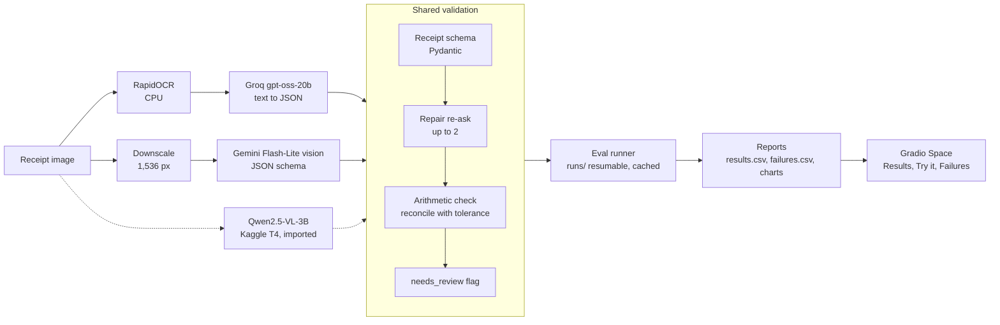

# Receipt-to-JSON Extractor

> A receipt photo goes in; validated JSON (line items, prices, totals) comes out — OCR+LLM vs a vision LLM, compared on accuracy, latency and cost.

> **Headline:** _[one sentence — filled from `reports/results.md` once A-naive, A and B are complete
> on the same 100 test receipts; no hand-typed numbers]_

## Results

<!-- results:start -->
| Pipeline | Model | Field F1 [95% CI] | Valid JSON | Reconciled | p50 / p95 latency | List cost / 1k | Run |
|---|---|---|---|---|---|---|---|
| A-naive | groq-oss-20b | 0.8200 [0.7653, 0.8702] | 0.94 | 0.59 | 2.4 s / 8.4 s | $0.3523 | `A-naive-5ed10911e9ae` |
| A | groq-oss-20b | 0.8464 [0.8014, 0.8894] | 0.98 | 0.63 | 7.1 s / 31.9 s | $0.3930 | `A-e8c045ee22e6` |
| B | gemini-flash-lite | 0.9572 [0.9305, 0.9782] | 1.00 | 0.85 | 4.1 s / 17.0 s | $0.9751 | `B-cea8aeff49d5` |
<!-- results:end -->

_Generated from `reports/` by `uv run receipt_extractor report readme` (test split, 100 receipts,
same ids for every row; latency excludes free-tier pacing)._


_[GIF recorded by the human from `docs/GIF_SCRIPT.md`; not yet recorded.]_

## Quickstart

Requires [uv](https://docs.astral.sh/uv/) and Python 3.12 (uv installs it if missing). Windows PowerShell:

```powershell
uv sync                                   # creates .venv and installs locked dependencies
Copy-Item .env.example .env               # then set GROQ_API_KEY / GEMINI_API_KEY
uv run receipt_extractor --help
uv run receipt_extractor llm ping --model groq-oss-20b
uv run ruff check . ; uv run mypy src ; uv run pytest -q
```

No database or Docker is needed: results are files under `runs/` and `reports/`.

Demo app (Gradio; Results · Try it · Failures · About) at http://127.0.0.1:7860:

```powershell
uv run python app.py
```

Uploads are read by pipeline A only and never sent to Gemini; sample receipts show stored A/B
results (`uv run receipt_extractor ui build-showcase` refreshes them). Hugging Face Space
deployment: [docs/DEPLOY.md](docs/DEPLOY.md).

## Architecture



Pipelines A, B and C all return the same `Receipt` model, so the scorer compares them field by
field. `A-naive` skips the repair and arithmetic steps and stays in every table as the baseline.
Uploads go to pipeline A only; Gemini sees public CORD images only. Details: [TRD.md](TRD.md) §2.

## Failures by cause

<!-- failures:start -->
| Failure cause | A-naive | A | B |
|---|---|---|---|
| ocr_misread | 8 | 11 | 0 |
| wrong_item_split | 7 | 7 | 0 |
| hallucinated_item | 6 | 5 | 6 |
| number_format | 4 | 5 | 0 |
| other | 20 | 14 | 10 |
| **Total** | 45 | 42 | 16 |
<!-- failures:end -->

_Hand-labelled from `reports/failures.csv` (gold vs prediction); the table is generated by
`report readme`._

## How it works, evaluation method

_[To write from the measured runs: how each pipeline works; the scorer (order-insensitive item
matching, 95 % bootstrap CIs); the labelled failure list from `reports/failures.csv` grouped by
cause; cost and latency (p50/p95 excluding free-tier pacing, wall clock alongside).]_

## Evaluation

See [TRD.md](TRD.md) §5 and §S4. Every experiment is a resumable run; re-running the same
command after a crash, Ctrl+C or an exhausted free-tier budget continues where it stopped.

```powershell
uv run receipt_extractor data prepare                                    # CORD-v2 validation + test → data/cord/ (~480 MB)
uv run receipt_extractor data stats --split test                         # items/receipt, formats, unmappable
uv run receipt_extractor eval run --config configs/runs/<variant>.yaml   # → runs/<run_id>/
uv run receipt_extractor eval import-predictions data/imports/<name>     # Kaggle outputs
uv run receipt_extractor report build                                    # → reports/results.csv|md + charts
uv run receipt_extractor report failures                                 # → reports/failures.csv
uv run receipt_extractor report readme                                   # fills the README's results and failure tables
```

`configs/runs/toy.yaml` exercises the whole loop on 20 synthetic cases without any model call.
`configs/runs/a-naive-val10.yaml` and `configs/runs/a-val10.yaml` run pipeline A (RapidOCR on the
CPU → Groq `gpt-oss-20b`, naive vs engineered) on 10 validation receipts; they need
`GROQ_API_KEY`, and model replies are cached under `.cache/llm/`, so a re-run is free.
`configs/runs/b-val10.yaml` runs pipeline B (the CORD image, downscaled to 1,536 px on its long
side → Gemini 3.5 Flash-Lite vision) on the same 10 receipts; it needs `GEMINI_API_KEY` and uses about half
of the free tier's 20 requests/day. Pipeline B accepts public dataset images only: it refuses any
other input before decoding it, and the `public_only` model alias refuses it again.
`configs/runs/c-local-val10.yaml` runs the same image path against a local model on the CPU
(`C-local`: Qwen3-VL-4B-Instruct through Ollama; no key, no limits, $0). It needs Ollama running
and `ollama pull qwen3-vl:4b-instruct` — the instruct build, not the bare `qwen3-vl:4b` tag
(that one is the thinking build and returns receipts without items).
Pipeline C (Qwen2.5-VL-3B) runs on a Kaggle T4: `notebooks/qwen_vl_cord.ipynb` is generated from
this repository (`uv run python -m receipt_extractor.pipelines.qwen_notebook`); its output goes into
`data/imports/qwen_vl/` and `uv run receipt_extractor eval import-predictions data/imports/qwen_vl`
turns it into a scored run.
`configs/runs/gold.yaml` scores the CORD test gold against itself (the scorer's calibration: every
comparative metric is 1.0; `reconcile` 0.84 is how often the printed receipts add up).

CORD-v2 (`naver-clova-ix/cord-v2`, CC-BY-4.0) is downloaded at a pinned revision; the three
records in `tests/fixtures/cord/` are excerpts of it under the same licence.

## Limitations

_To be written after the benchmark._

## What I'd do differently

_To be written after the benchmark._
