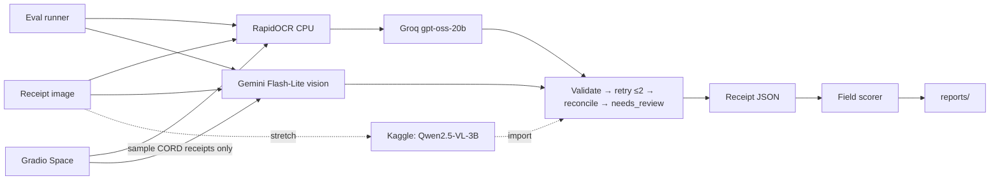

# Technical Requirements Document — Receipt-to-JSON Extractor

> A receipt photo goes in; validated JSON (line items, prices, totals) comes out — OCR+LLM vs a vision LLM, compared on accuracy, latency and cost.

Project documentation: [PRD.md](PRD.md) · **TRD.md** · [APPFLOW.md](APPFLOW.md) · [UI_UX_DESIGN.md](UI_UX_DESIGN.md) · [BACKEND_SCHEMA.md](BACKEND_SCHEMA.md) · [IMPLEMENTATION_PLAN.md](IMPLEMENTATION_PLAN.md) · [WORKLOG.md](WORKLOG.md) · [IMPLEMENTATION_PROMPTS.md](IMPLEMENTATION_PROMPTS.md) · [CLAUDE.md](CLAUDE.md) · [PROMPT_PLAYBOOK.md](PROMPT_PLAYBOOK.md)

| Field | Value |
|---|---|
| Project | P01 · `01-receipt-extractor` |
| Type | Quick win 1 of 3 |
| Skill it adds | Multimodal, structured output |
| Target role signal | AI/GenAI Engineer · document AI · structured outputs · evaluation |
| Effort | ≈ 3.75 focused days (sum of task estimates; the ideas doc says 2–3 days) |
| Public artefact | Hugging Face Space (upload a receipt, see both pipelines side by side) |
| Interface | Gradio 6 → Hugging Face Space |
| Status | Specification v2 (lean) · 2026-10-22 |

---

## 1. Overview

A small benchmarking package: dataset normaliser, one output schema, two (optionally three)
extraction pipelines behind one protocol, a validation/reconciliation layer, the shared eval runner,
and a Gradio Space. The LLM provider layer already exists (v1 M0.3) and is kept as-is.

## 2. Architecture



## 3. Models and providers

| Alias | Model | Use |
|---|---|---|
| `groq-oss-20b` | Groq `openai/gpt-oss-20b` | Pipeline A structuring |
| `gemini-flash-lite` | Gemini 3.5 Flash-Lite (pinned in `models.yaml`, `public_only`) | Pipeline B (since M2.1; cheaper than Flash) |
| `gemini-flash` | Gemini 3.8 Flash (pinned in `models.yaml`, `public_only`) | kept for comparison; not used by a pipeline |
| `ollama-qwen3-vl-4b` | Qwen3-VL-4B-Instruct Q4_K_M via local Ollama (`ollama_chat/qwen3-vl:4b-instruct`, CPU, `num_ctx` 8,192) | Variant `C-local` (B's code path, local; added in M2.1) |
| `qwen-vl-3b` | `Qwen/Qwen2.5-VL-3B-Instruct` on Kaggle T4 (offline; commit `66285546d2b8`, Qwen Research licence) | Pipeline C (stretch, M2.4) |
| OCR | RapidOCR (ONNX, pip-only, CPU) | Pipeline A text; Tesseract optional ablation only if the human installs it |

**Budget.** OCR text + schema prompt ≈ 1.5K tokens per receipt → 100 test receipts ≈ 150K tokens,
inside one Groq day. Gemini's free tier has a low requests-per-day cap: plan B's 100 receipts across
days (the budget tracker pauses and resumes) and log the plan in WORKLOG.

## 4. Components

### 4.1 `Receipt` schema and normaliser
Pydantic models with `Decimal` money; one `parse_amount()` handling `1.000`, `1,000.50`, `Rp`
prefixes and blanks. CORD ground truth (`menu`, `sub_total`, `total`) maps into the same schema.
Implementation (M1.1): `core/amounts.py` (`parse_amount`, `amount_format`), `core/receipt.py`
(`Receipt`, `Item`; money serialised as strings), `data/cord_mapping.py` (pure gold mapping, rules
in BACKEND_SCHEMA §1.1), `data/cord.py` (`cli data prepare`: pinned revision + pinned per-file
SHA-256, streamed parquet → images, gold, manifest), `data/stats.py` (`cli data stats`). The eval
runner reads a prepared split through the `cord` dataset kind (`{kind: cord, split: test}`).

### 4.2 Pipeline protocol
`extract(image) -> ExtractionResult(receipt | None, raw_text, attempts, stage_latency, tokens, cost)`.
Pipelines never return ad-hoc dicts.

Implementation (M1.3): `pipelines/base.py` (`Pipeline` protocol:
`async extract(image: bytes, *, origin, tags) -> ExtractionResult`; `origin` is the request's
`data_origin`, so `public_only` models refuse user uploads), `core/extraction.py`
(`ExtractionResult`, BACKEND_SCHEMA §1.2), `pipelines/ocr.py`, `pipelines/prompts.py`,
`pipelines/pipeline_a.py`, `pipelines/tasks.py` (eval task `pipeline_a`).
- **OCR stage (A).** Image bytes are untrusted: ≤ 32 MB, PNG/JPEG/WebP magic, ≤ 8,192 px per side
  and ≤ 40 MP checked from the header before decoding; EXIF orientation applied; decoded in memory
  only. RapidOCR 3 (ONNX Runtime, CPU) with the PP-OCRv6 small det/rec models **bundled in the
  wheel**, passed by path so it never downloads. Settings chosen on validation timing: no angle
  classifier, detection resized to max side 960, 4 intra-op threads (default settings took ≈ 4 s
  per receipt). One engine call at a time per stage; `latency_ms` excludes the lock wait; over
  2,000 ms a metadata-only warning is logged. Boxes are grouped into printed lines (vertical
  overlap) and joined left to right with ` | `.
- **Structuring (A).** Versioned prompts (`a-v1` … `a-v3`; the version is a run param, so part of
  the run id; published versions are never edited). OCR text goes between `<ocr_text>` tags,
  delimiter look-alikes inside it are replaced, it is capped at 16,000 chars, and the system prompt
  says it is untrusted data whose instructions must not be followed. Amounts are asked for as
  printed strings so `parse_amount()` stays the only number interpreter. `Receipt` is the
  `response_model`; `max_tokens` 4,096 (gpt-oss reasons before answering).
- **Modes.** `naive` (`A-naive`): one call with `repair = false`, an invalid reply is final.
  `engineered` (`A`): the layer's one repair (§S3); M2.2 adds the second retry, reconciliation and
  `needs_review`. Same prompt and model in both, so the difference is the validation machinery.
  No OCR text → no model call (`failure = ocr_empty`).

Implementation (M2.1): `pipelines/images.py` (the untrusted-image checks, now shared by A's OCR
stage and B, plus `prepare_model_image`), `pipelines/pipeline_b.py`, `pipelines/replies.py` (reply →
`Receipt` | failure, shared by A and B), prompt `b-v1` in `pipelines/prompts.py`, eval task
`pipeline_b` in `pipelines/tasks.py`.
- **Data policy (B).** `PipelineB.extract` accepts `origin = public_dataset` only and raises
  `DataPolicyError` before the image is decoded; every Gemini alias is `public_only`, so the
  LLM layer would refuse a user upload as well (two independent guards, both tested).
- **Image (B).** Same checks as A; downscaled to `max_side` 1,536 px on the long side (LANCZOS,
  never upscaled) and re-encoded as JPEG q90 in memory, which also drops EXIF/GPS metadata. These
  are run params (`image: {max_side, format, jpeg_quality}`), so part of the run id. The size sent
  and the provider-reported image input tokens (`image_tokens_in`) are recorded.
- **Call (B).** System prompt `b-v1` (a-v3's field rules for an image; printed text is untrusted),
  user message = image + one instruction; `Receipt` schema, temperature 0, run seed, `max_tokens`
  8,192 (Gemini 3.x Flash models may think before answering), the layer's one repair, model
  `gemini-flash-lite` (switched from `gemini-flash` on 2026-10-22: cheaper, and Flash returned
  sustained 503s). Variant `B`.
- **Local vision variant `C-local` (M2.1).** Same `PipelineB` code path with `variant: C-local`,
  `model: ollama-qwen3-vl-4b`, images capped at 1,024 px, `timeout_s` 600 (CPU), concurrency 1
  (`configs/runs/c-local-val10.yaml`). Must be the **instruct** build: Ollama's bare
  `qwen3-vl:4b` tag is the thinking build, which under a JSON schema answers in its reasoning
  channel with only `{total, currency}`. Nothing leaves the machine, but the dataset-only origin
  guard still applies (offering it for uploads is a product decision, not taken).
- **Pipeline C (M2.4, Kaggle).** `notebooks/qwen_vl_cord.ipynb` is *generated* by
  `uv run python -m receipt_extractor.pipelines.qwen_notebook` from this repository: prompt `b-v1`
  (B's), the pinned CORD revision + test parquet SHA-256, and every test image's SHA-256 → case id,
  so the notebook finds our ids by content (a test fails when the committed notebook is stale).
  On a T4: `transformers==4.51.3`, `accelerate==1.6.0`, float16 weights, images ≤ 1,536 px (B's
  downscale), greedy decoding, ≤ 2,048 new tokens, resumable `predictions.jsonl` with the **raw
  reply text** + latency/tokens, and `manifest.json` with GPU seconds. `eval import-predictions`
  validates the replies against `Receipt` (`prediction_format: receipt_reply`), so C rows are scored
  and flagged like A/B rows. One call per receipt: no re-ask loop, no constrained decoding.

### 4.3 Validation, retry and reconciliation
Validate → on failure, re-ask with the Pydantic errors (max 2 attempts) → arithmetic check
(Σ item prices vs subtotal within a tolerance; subtotal + tax vs total) → `needs_review = True` when
invalid after retries or not reconciled. Naive mode skips all of this and is reported as the baseline.

Implementation (M2.2): "max 2 attempts" is read as **up to 2 re-asks** (≤ 3 calls), as recorded in
M1.3; it is the run param `max_repairs` (1–2, default 2) of `pipeline_a` (engineered) and
`pipeline_b`. The LLM layer runs the loop (`LLMRequest.max_repairs`): each re-ask appends the
previous reply and its Pydantic errors to the conversation; repair stages are `llm:repair`,
`llm:repair2`. `ExtractionResult.attempts` is the exact call count. `pipelines/replies.review()`
then applies `core/reconcile.reconcile` with the run param `reconcile_tolerance` (share of the
total, default 0.005, floor 0.01; the scorer's `reconcile` metric always uses the defaults):
`reconciled` (null without a valid receipt), `reconcile_diff` (signed diff of the failing check —
item sum vs subtotal if that fails, else totals; 0 when reconciled) and `needs_review` (invalid
after retries, nothing extracted, or not reconciled). `A-naive` leaves all three null. There is no
re-ask on an arithmetic mismatch: the flag is for a human. Known false positive: receipts whose
item prices include tax while the subtotal is printed net (2/100 validation gold).

### 4.4 Scorer
Scalar fields: exact match after normalisation. Items: Hungarian matching on (name similarity, price)
so order, splits and merges are scored fairly; report item-level P/R/F1 plus per-field F1.

Implementation (M1.2): `eval/scorer.py` (pure; registry metrics), `core/reconcile.py` (shared with
M2.2), `eval/oracle.py` (`gold` task).
- A prediction is an `ExtractionResult` (its `receipt`) or a bare `Receipt`, in the JSON form stored
  in `results.jsonl`. One that does not validate as `Receipt` is invalid (`valid_json = 0`) and is
  scored as an empty receipt; scoring never raises on a prediction.
- Scalars (`subtotal`, `tax`, `total`) compare as `Decimal` after `Receipt` validation: equal → TP,
  wrong → FP + FN, only predicted → FP, only gold → FN, absent on both → not applicable.
- Items: `scipy.optimize.linear_sum_assignment` over a weight that ranks, in order, full matches
  (normalised name similarity ≥ 0.8 **and** equal price), name-only agreements, price-only
  agreements and total name similarity. Names: NFKC + casefold + collapsed whitespace, compared with
  rapidfuzz's normalised Indel ratio. One-to-one, so a split or merged line costs exactly the lines
  that no longer agree. P = TP / predicted, R = TP / gold (0 when the other side has items and this
  one has none, not applicable when both are empty). `qty`, `unit_price` and `currency` are not scored.
- Registry metrics (all with bootstrap CIs): `field_f1` (primary: micro F1 over the receipt's items
  and scalar fields, averaged over receipts), `items_precision`, `items_recall`, `items_f1`,
  `subtotal_f1`, `tax_f1`, `total_f1`, `valid_json`, `reconcile`. Per-field values are per receipt
  and averaged over the receipts where the field applies — the registry aggregates per-case means.
- `reconcile` checks the prediction itself (Σ items = subtotal; subtotal + tax = total, or
  subtotal = total with tax included; tolerance max(0.01, 0.5 % of total)); service charges and
  discounts are not in the schema, so such receipts do not reconcile. The CORD test gold reconciles
  on 84/100.
- Metrics may offer `explain()`; the runner and importer store it as `details.field_scores` and
  `details.item_matches` (BACKEND_SCHEMA §1.3), overriding same-named task/import details.
- Calibration: `configs/runs/gold.yaml` scores the test gold against itself — every comparative
  metric is 1.0 (run `gold-9988f5dc0330`).

## 5. Evaluation methodology

- Benchmark: the 100-receipt CORD test split, fixed ids; tuning only on validation.
- Variants: `A-naive`, `A`, `B`, `C` (stretch). Same ids for all.
- Metrics per §5 of the PRD with bootstrap CIs; per-stage latency (OCR vs LLM).
- Failure analysis: 20–30 failures labelled by cause, one round of fixes, before/after.

## 6. Performance budgets

| Path | Budget |
|---|---|
| RapidOCR per receipt (laptop CPU) | < 2 s |
| Space, pipeline A end to end | p95 < 8 s |

Measured on 2026-10-27, development laptop CPU, no cache, one upload at a time, 20 CORD validation
receipts through `ui.live.default_live_service` (16 completed; 4 were refused by the 5 MB upload
cap). Service time excludes the Groq free plan's pacing waits (§S5); the waits are reported, not
counted:

| Measure | Result | Budget |
|---|---|---|
| RapidOCR alone, 16 receipts | median 1.6 s, max 1.9 s | met |
| Pipeline A service time | median 3.2 s, p95 7.1 s (linear interpolation), max 11.6 s | met, narrowly: n = 16, and the max is the first request (a 9.8 s model call) |
| Wall clock including pacing | median 13.7 s, p95 18.4 s | not budgeted: 8,000 tokens/min on the free plan |

An earlier run the same day gave OCR 1.5–7.1 s and p95 15.0 s while the machine was busy with
something else (cause not identified, CPU contention is the likely one; the same OCR timed alone gave 1.3–1.9 s). It is discarded as
contaminated. A free Space CPU is likely slower than this laptop, so the budgets must be
re-measured after deployment.

## 7. Risks

| Risk | Mitigation |
|---|---|
| Gemini free-tier RPD too low for 100 receipts/day | budget tracker pauses; spread across days |
| OCR misses small text | report OCR-stage failures separately; try 2× upscale as the one fix |
| Indonesian number formats | single tested `parse_amount()` |
| Ported v1 code drifts from the lean spec | M0.R removes the DB layer before new work |

---

## S1. Stack (shared lean baseline)

| Layer | Choice |
|---|---|
| Language | Python 3.12, managed by `uv` (project `.venv`, never global installs) |
| CLI | Typer — every experiment and report is one documented command |
| Config | Pydantic v2 + `pydantic-settings` reading `.env`; secrets as `SecretStr` |
| LLM access | The provider layer ported from P01 (`src/<pkg>/llm/`, LiteLLM underneath) — §S3 |
| Data | `huggingface_hub` (revision and file SHA-256 pinned) + `pyarrow` (streamed parquet); the heavier `datasets`/pandas are not needed |
| Scoring | `scipy` (`linear_sum_assignment`, Hungarian item matching) + `rapidfuzz` (item-name similarity) |
| OCR | `rapidocr` 3 + `onnxruntime` (CPU; det/rec models ship in the wheel, no runtime download); Pillow decodes images |
| Results | Files: `runs/<run_id>/*.jsonl|json` → `reports/*.csv|md|png` (committed). **No database.** |
| UI | Gradio 6 `Blocks` in `app.py` → Hugging Face Space (Gradio SDK, free CPU); Gradio 6.30 with Pillow 13 kept over its `<13` cap (M3.2, see §S7) |
| GPU work | Kaggle notebooks under `notebooks/`, versions pinned, run by the human; outputs imported by a CLI command |
| Testing | pytest, pytest-asyncio, `respx` for HTTP mocking, `FakeProvider` for LLM calls; coverage ≥ 80 % on `src/<pkg>/core` |
| Quality | `ruff` (lint + format), `mypy --strict` on `src/`, `pip-audit` |

## S2. Repository layout

```text
01-receipt-extractor/
├── src/receipt_extractor/
│   ├── core/                # domain logic — pure, typed, no I/O at import time
│   ├── llm/                 # provider client, cache, rate limiter, pricing (§S3) — ported from P01
│   ├── eval/                # run configs, runner, metrics, reports (§S4)
│   ├── data/                # dataset download + normalisation to gold files (`cli data …`)
│   ├── pipelines/           # Pipeline protocol, image checks, OCR stage, prompts, pipelines A, B
│   ├── ui/                  # Gradio Blocks + theme (no business logic in callbacks)
│   └── cli.py               # Typer CLI: data / eval / report / llm
├── app.py                   # HF Space entry point → receipt_extractor.ui
├── notebooks/               # Kaggle notebooks (GPU work), run by the human
├── configs/                 # models.yaml, pricing.yaml, runs/*.yaml
├── data/                    # .gitignored; populated by `cli data …`
├── runs/                    # .gitignored; raw run artefacts (§S4)
├── reports/                 # committed; results tables, charts, failure lists
├── tests/                   # unit/, live/ (opt-in)
├── pyproject.toml / uv.lock
├── .env.example             # every variable documented, no real values
└── README.md
```

## S3. LLM provider layer (ported from P01)

All model calls go through one module so cost, latency, caching and rate limits are uniform.
P01's `llm/` package (M0.3, 2026-10-19) already implements all of this; later projects copy it and
rename the package.

- **Interface:** `async complete(LLMRequest) -> LLMResponse` and `async embed(...)`. Requests carry
  `model_alias`, messages (text and inline images), `temperature`, `max_tokens`, optional
  `response_model` (Pydantic → JSON schema), `seed`, `tags` (run id, case id, stage) and `data_origin`.
- **Model registry:** `configs/models.yaml` maps aliases (`groq-oss-20b`, `groq-oss-120b`,
  `gemini-flash`, `gemini-flash-lite`, `ollama-*`) to LiteLLM strings, limits and a `data_policy`
  (`public_only` aliases refuse anything but public-dataset or synthetic content). Code never
  hard-codes model strings.
- **Disk cache** under `.cache/llm/`, SHA-256 keyed on model string + messages + params + schema.
  ON for eval runs (re-runs cost nothing), OFF for live demo traffic.
- **Rate limits and budgets:** token-bucket RPM/TPM per alias plus a persisted per-day RPD/TPD
  budget, so a sweep **pauses** instead of hitting 429s. On Groq's free plan tokens-per-day is
  usually the binding limit: `n ≈ TPD × days ÷ tokens_per_case`. Re-check limits in the console.
  The local tracker counts per **UTC day**; Groq's TPD is a **rolling window** (observed
  2026-10-23: refused at 199,749/200,000 while the local day showed ~143K), so the provider can
  say no first. A 429 that will not clear within a call — `Retry-After` above the in-call cap
  (120 s) or a message naming a per-day limit ("tokens per day (TPD)", Gemini "…PerDay…") — is
  raised as `ProviderQuotaExhaustedError`, a `BudgetExhaustedError`, so a run **pauses** on it
  (no error rows) and resumes later.
- **Retries:** jittered exponential backoff on 429/5xx/timeouts (max 5 attempts, honours
  `Retry-After`); no retry on 4xx validation errors or on provider daily quotas; hard timeout per
  call (default 60 s).
- **Structured output:** schema sent as `response_format`, reply validated with Pydantic, up to
  `max_repairs` (1–2, default 1; pipelines use 2 since M2.2) repair attempts with the validation
  errors appended, then `schema_valid = false`. `repair = false` on the request (naive baselines)
  makes exactly one call; it is part of the cache key only when set, so existing entries stay
  valid. `max_repairs` is *not* part of the key: a cached entry is reused only when consistent
  with the request's budget (valid after no more repairs than allowed, or invalid after exactly
  the allowed number), otherwise it is a miss and is replaced — so raising the budget re-sends
  nothing that was already valid. A provider-side schema rejection (Groq HTTP 400
  `json_validate_failed`) is returned by the adapter as an invalid reply (its
  `failed_generation`, `finish_reason = schema_rejected`), not raised, so it is repaired or
  reported as invalid output like any other. Gemini rejects a whole request (HTTP 400
  `INVALID_ARGUMENT`) whose schema has length bounds (`maxItems`, `minItems`, `minLength`,
  `maxLength`), so the adapter strips them from the schema sent to `gemini/` models (M2.1); the
  client still validates replies against the full Pydantic model and caches on the full schema.
  Ollama decodes against the schema as a grammar and a small model then writes only the required
  keys (`Receipt`: just `total`), so for `ollama/`/`ollama_chat/` models the schema sent marks
  every object property required (nullable fields stay nullable).
- **Alias options:** an alias may set provider request options from an allow-list (`num_ctx`,
  `num_thread`, `keep_alive`), passed to LiteLLM but never able to override model, key, endpoint,
  timeout or retries; they join the cache key only when set. Ollama aliases may use the
  `ollama/` (generate) or `ollama_chat/` (chat, needed for images) route.
- **Accounting:** every call records provider, model, tokens in/out, latency (`perf_counter`; time
  in the provider call incl. retry backoff), `wait_ms` (time queued for the daily budget, the rate
  limiter or a concurrency slot — free-tier pacing, kept out of latency), image input tokens when
  the provider reports them (Gemini, via LiteLLM's `prompt_tokens_details.image_tokens`), cache hit, retries, `list_price_usd` from dated `configs/pricing.yaml`, `actual_cost_usd` (0 on free
  tiers). Sink: `runs/<run_id>/llm_calls.jsonl` (v1's database sink is not used in v2).
- **Privacy:** keys never logged; provider error bodies sanitised; prompts logged in full only for
  eval runs on public data.

## S4. Evaluation framework

- A **run config** (`configs/runs/*.yaml`, loaded with `yaml.safe_load`) names the dataset split,
  sample ids/size and seed, the variant and its parameters, model aliases and metrics. Run id =
  short hash of the resolved config + dataset manifest hash.
- The **runner** iterates cases with bounded concurrency (default 4), appends one JSON line per case
  to `runs/<run_id>/results.jsonl` immediately and **resumes** by skipping finished case ids.
  A case-level exception becomes `status = error`; it never aborts the run. `eval run
  --retry-errors` also re-runs cases whose *last* row is an error; the new row is appended (never
  rewritten), and every reader (summary, reports, failures export, showcase) takes the last row
  per case.
- At the end it writes `summary.json` (metrics with 95 % bootstrap CIs where meaningful, latency
  p50/p95, tokens, list cost per 1k) and `manifest.json` (git SHA if available, package versions,
  dataset hash, resolved config).
- `cli report build` rebuilds `reports/results.csv`, `reports/results.md` and the charts
  (`primary_metric.png`, `cost_per_1k.png`) from **all** completed runs (latest run per variant ×
  dataset split); `cli report failures` exports `fail`/`error` cases to `reports/failures.csv` for
  hand-labelling and keeps existing labels on re-export.
- `cli eval import-predictions <dir>` turns Kaggle notebook outputs (`data/imports/<name>/`:
  `manifest.json` + `predictions.jsonl`, BACKEND_SCHEMA §S2) into a normal, scored run directory,
  so GPU variants sit in the same table as CPU and API variants.
- Implementation (M0.4, `src/receipt_extractor/eval/`): `config.py` (schema + run id; `concurrency`
  and `runs_dir` are not part of the run id), `runner.py` (queue of size `concurrency` → at most
  2 × concurrency cases in memory; per-run OS file lock; a partial last line from a crash is cut
  on resume; `BudgetExhaustedError` → `paused`, exit code 3), `metrics.py` (registry,
  percentile bootstrap seeded by `"<seed>:<metric>"`), `summary.py`, `report.py`, `importer.py`,
  `datasets.py` (`synthetic`, `jsonl` and — M1.1 — `cord` kinds), `toy.py`
  (`configs/runs/toy.yaml`, no model calls); M1.2: receipt metrics in `scorer.py` (loaded on first
  metric lookup) and the `gold` task in `oracle.py` (`configs/runs/gold.yaml`). Error rows count as 0 for every metric.
- Paths named by configs and CLI options are resolved (symlinks followed) and confined:
  configs → `configs/`, datasets and imports → `data/`, run dirs → `runs/`, reports → `reports/`.

## S5. Measurement rules

- Latency: wall-clock per case and per stage; report p50/p95 (p99 where n ≥ 500). The headline
  p50/p95 exclude time a case spent queued for free-tier pacing (`ResultRow.wait_ms`: daily budget,
  rate limiter, concurrency slot), which measures the free plan, not the pipeline (M1.3: Groq TPM
  pacing turned ≈ 2 s of model time into a ≈ 29 s case p50). Wall clock including that wait is
  reported alongside (`wall_p50_ms`/`wall_p95_ms`). Provider retry backoff (429/503) stays *in*
  the headline: it is what a caller of that provider experiences.
- Cost: list-price USD per 1k cases from logged tokens × dated price table; local models report
  compute time instead (CPU-ms or GPU-s) and $0; actual spend reported separately (expected $0).
- Never compare variants on different samples. Fixed seed, fixed sample ids per split.
- Every number in the README is produced by one documented CLI command and traceable to a run id.

## S6. Configuration and secrets

- `.env.example` documents every key (`GROQ_API_KEY`, `GEMINI_API_KEY`, `HF_TOKEN`,
  `OLLAMA_BASE_URL`, `LLM_*` paths and limits, `DEMO_MODE`, …) with no real values.
- Secrets are never logged, echoed in errors, written to `runs/`, or committed. On the Space they
  are Space secrets set by the human.

## S7. Public demo hardening (Gradio Space)

- `demo.queue(default_concurrency_limit=2, max_size=20)`; input caps (text ≤ 2,000 chars, images
  ≤ 5 MB and ≤ 4,096 px per side) validated server-side, not only in the component.
- `DEMO_MODE=true`: live LLM calls use a small per-day budget; when it is exhausted the UI falls back
  to cached/showcase results with a clear banner instead of erroring.
- User input is processed in memory only and never logged; only metadata (latency, path, cost) is.
- Errors shown as plain language + a short request id; no stack traces or provider messages.
- Startup never downloads datasets; model weights load from the Hub with a pinned revision.

Implementation (M3.2): `src/receipt_extractor/ui/` — Gradio-free `views.py` (column view-models,
badges with text), `reports.py` (Results/Failures from `reports/`), `showcase.py` (bundled samples),
`live.py` (uploads), `presenters.py`; `app.py` (Blocks: Results · Try it · Failures · About) and
`theme.py`. Decisions and how each rule above is met:
- **Gradio 6.30, Pillow 13 (human decision 2026-10-23).** Gradio 5.50 has known advisories (fixed
  in 6.6–6.16) and every Gradio release caps Pillow < 13, while Pillow < 13 has known CVEs on the
  decoding path. `[tool.uv] override-dependencies = ["pillow>=13.0.0"]`; covered by the
  `gradio_client` smoke tests. The Space installs Gradio from `sdk_version`; `requirements.txt`
  (exported from `uv.lock`, Gradio subtree pruned) pins Pillow 13 and `app.py` puts `src/` on the
  path instead of pip-installing the package (docs/DEPLOY.md).
- **Queue/caps:** `queue(default_concurrency_limit=2, max_size=20)`; `launch(max_file_size="5mb")`
  plus `ui.live.check_upload` (≤ 5 MB, PNG/JPEG/WebP magic, ≤ 4,096 px per side from the header,
  before decoding). There is no free-text input, so the 2,000-char cap has nothing to apply to.
- **Uploads:** pipeline A only (`origin="user_upload"`; no code path to B; the layer would refuse a
  `public_only` alias too). Gradio writes an upload to its temp dir before any callback runs; the
  callback reads it into memory and deletes it at once (only inside temp dirs), and
  `Blocks(delete_cache=(300, 300))` sweeps leftovers — the closest Gradio allows to "never written".
  No disk cache for live calls. Logs: request id, bytes, ms, validity — never content.
- **Budget:** `DEMO_MODE=true` caps live extractions at `DEMO_DAILY_REQUESTS` per UTC day; a
  provider `BudgetExhaustedError` stops live calls until the next UTC day; rate limits pause the
  call. Either way: "Live calls are paused for today" banner; samples keep working.
- **Samples:** `receipt_extractor ui build-showcase` bundles 6 CORD **validation** receipts
  (display JPEGs ≤ 1,024 px, metadata stripped) with their stored A and B results and run ids; B
  never runs live on the Space. Cached rows show "replayed from cache" instead of a model time.
- **Results/Failures:** read only from `reports/results.csv`, the report PNGs (with alt text and
  a table equivalent), `reports/failures.csv` and `reports/failure_examples.jsonl` (M3.1); missing
  files are explicit empty/in-progress states. Analytics off; no share buttons on images.

## S8. Quality gates (must pass before any task is complete)

```text
uv run ruff check . && uv run ruff format --check .
uv run mypy src
uv run pytest -q
uv run pip-audit
```

## S9. Windows development notes

- Commands are documented for PowerShell; every Python entry point runs through `uv run`.
- `pathlib` everywhere; `.gitattributes` sets `* text=auto eol=lf`.
- uv cache (C:) and project (D:) are on different drives: set `UV_LINK_MODE=copy` to silence the
  hardlink warning.
- CPU-only local inference: keep local models ≤ 4B parameters at Q4; anything heavier → Groq or Kaggle.
- Kaggle sessions end after ~12 h and GPU quota resets weekly: notebooks save results to files after
  every run and each notebook covers one setup.
