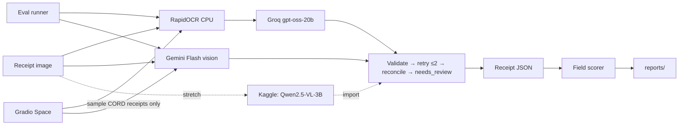

# Technical Requirements Document — Receipt-to-JSON Extractor

> A receipt photo goes in; validated JSON (line items, prices, totals) comes out — OCR+LLM vs a vision LLM, compared on accuracy, latency and cost.

Project documentation: [PRD.md](PRD.md) · **TRD.md** · [APPFLOW.md](APPFLOW.md) · [UI_UX_DESIGN.md](UI_UX_DESIGN.md) · [BACKEND_SCHEMA.md](BACKEND_SCHEMA.md) · [IMPLEMENTATION_PLAN.md](IMPLEMENTATION_PLAN.md) · [WORKLOG.md](WORKLOG.md) · [IMPLEMENTATION_PROMPTS.md](IMPLEMENTATION_PROMPTS.md) · [CLAUDE.md](CLAUDE.md) · [PROMPT_PLAYBOOK.md](PROMPT_PLAYBOOK.md)

| Field | Value |
|---|---|
| Project | P01 · `01-receipt-extractor` |
| Type | Quick win 1 of 3 |
| Skill it adds | Multimodal, structured output |
| Target role signal | AI/GenAI Engineer · document AI · structured outputs · evaluation |
| Effort | ≈ 3.75 focused days (sum of task estimates; the ideas doc says 2–3 days) |
| Public artefact | Hugging Face Space (upload a receipt, see both pipelines side by side) |
| Interface | Gradio 5 → Hugging Face Space |
| Status | Specification v2 (lean) · 2026-10-22 |

---

## 1. Overview

A small benchmarking package: dataset normaliser, one output schema, two (optionally three)
extraction pipelines behind one protocol, a validation/reconciliation layer, the shared eval runner,
and a Gradio Space. The LLM provider layer already exists (v1 M0.3) and is kept as-is.

## 2. Architecture



## 3. Models and providers

| Alias | Model | Use |
|---|---|---|
| `groq-oss-20b` | Groq `openai/gpt-oss-20b` | Pipeline A structuring |
| `gemini-flash` | Gemini Flash (alias pinned in `models.yaml`, `public_only`) | Pipeline B |
| `qwen-vl-3b` | `Qwen/Qwen2.5-VL-3B-Instruct` on Kaggle T4 (offline) | Pipeline C (stretch) |
| OCR | RapidOCR (ONNX, pip-only, CPU) | Pipeline A text; Tesseract optional ablation only if the human installs it |

**Budget.** OCR text + schema prompt ≈ 1.5K tokens per receipt → 100 test receipts ≈ 150K tokens,
inside one Groq day. Gemini's free tier has a low requests-per-day cap: plan B's 100 receipts across
days (the budget tracker pauses and resumes) and log the plan in WORKLOG.

## 4. Components

### 4.1 `Receipt` schema and normaliser
Pydantic models with `Decimal` money; one `parse_amount()` handling `1.000`, `1,000.50`, `Rp`
prefixes and blanks. CORD ground truth (`menu`, `sub_total`, `total`) maps into the same schema.

### 4.2 Pipeline protocol
`extract(image) -> ExtractionResult(receipt | None, raw_text, attempts, stage_latency, tokens, cost)`.
Pipelines never return ad-hoc dicts.

### 4.3 Validation, retry and reconciliation
Validate → on failure, re-ask with the Pydantic errors (max 2 attempts) → arithmetic check
(Σ item prices vs subtotal within a tolerance; subtotal + tax vs total) → `needs_review = True` when
invalid after retries or not reconciled. Naive mode skips all of this and is reported as the baseline.

### 4.4 Scorer
Scalar fields: exact match after normalisation. Items: Hungarian matching on (name similarity, price)
so order, splits and merges are scored fairly; report item-level P/R/F1 plus per-field F1.

## 5. Evaluation methodology

- Benchmark: the 100-receipt CORD test split, fixed ids; tuning only on validation.
- Variants: `A-naive`, `A`, `B`, `C` (stretch). Same ids for all.
- Metrics per §5 of the PRD with bootstrap CIs; per-stage latency (OCR vs LLM).
- Failure analysis: 20–30 failures labelled by cause, one round of fixes, before/after.

## 6. Performance budgets

| Path | Budget |
|---|---|
| RapidOCR per receipt (laptop CPU) | < 2 s |
| Space, pipeline A end to end | p95 < 8 s |

## 7. Risks

| Risk | Mitigation |
|---|---|
| Gemini free-tier RPD too low for 100 receipts/day | budget tracker pauses; spread across days |
| OCR misses small text | report OCR-stage failures separately; try 2× upscale as the one fix |
| Indonesian number formats | single tested `parse_amount()` |
| Ported v1 code drifts from the lean spec | M0.R removes the DB layer before new work |

---

## S1. Stack (shared lean baseline)

| Layer | Choice |
|---|---|
| Language | Python 3.12, managed by `uv` (project `.venv`, never global installs) |
| CLI | Typer — every experiment and report is one documented command |
| Config | Pydantic v2 + `pydantic-settings` reading `.env`; secrets as `SecretStr` |
| LLM access | The provider layer ported from P01 (`src/<pkg>/llm/`, LiteLLM underneath) — §S3 |
| Data | Hugging Face `datasets` (revision pinned), pandas, pyarrow |
| Results | Files: `runs/<run_id>/*.jsonl|json` → `reports/*.csv|md|png` (committed). **No database.** |
| UI | Gradio 5 `Blocks` in `app.py` → Hugging Face Space (Gradio SDK, free CPU) |
| GPU work | Kaggle notebooks under `notebooks/`, versions pinned, run by the human; outputs imported by a CLI command |
| Testing | pytest, pytest-asyncio, `respx` for HTTP mocking, `FakeProvider` for LLM calls; coverage ≥ 80 % on `src/<pkg>/core` |
| Quality | `ruff` (lint + format), `mypy --strict` on `src/`, `pip-audit` |

## S2. Repository layout

```text
01-receipt-extractor/
├── src/receipt_extractor/
│   ├── core/                # domain logic — pure, typed, no I/O at import time
│   ├── llm/                 # provider client, cache, rate limiter, pricing (§S3) — ported from P01
│   ├── eval/                # run configs, runner, metrics, reports (§S4)
│   ├── ui/                  # Gradio Blocks + theme (no business logic in callbacks)
│   └── cli.py               # Typer CLI: data / eval / report / llm
├── app.py                   # HF Space entry point → receipt_extractor.ui
├── notebooks/               # Kaggle notebooks (GPU work), run by the human
├── configs/                 # models.yaml, pricing.yaml, runs/*.yaml
├── data/                    # .gitignored; populated by `cli data …`
├── runs/                    # .gitignored; raw run artefacts (§S4)
├── reports/                 # committed; results tables, charts, failure lists
├── tests/                   # unit/, live/ (opt-in)
├── pyproject.toml / uv.lock
├── .env.example             # every variable documented, no real values
└── README.md
```

## S3. LLM provider layer (ported from P01)

All model calls go through one module so cost, latency, caching and rate limits are uniform.
P01's `llm/` package (M0.3, 2026-10-19) already implements all of this; later projects copy it and
rename the package.

- **Interface:** `async complete(LLMRequest) -> LLMResponse` and `async embed(...)`. Requests carry
  `model_alias`, messages (text and inline images), `temperature`, `max_tokens`, optional
  `response_model` (Pydantic → JSON schema), `seed`, `tags` (run id, case id, stage) and `data_origin`.
- **Model registry:** `configs/models.yaml` maps aliases (`groq-oss-20b`, `groq-oss-120b`,
  `gemini-flash`, `ollama-*`) to LiteLLM strings, limits and a `data_policy`
  (`public_only` aliases refuse anything but public-dataset or synthetic content). Code never
  hard-codes model strings.
- **Disk cache** under `.cache/llm/`, SHA-256 keyed on model string + messages + params + schema.
  ON for eval runs (re-runs cost nothing), OFF for live demo traffic.
- **Rate limits and budgets:** token-bucket RPM/TPM per alias plus a persisted per-day RPD/TPD
  budget, so a sweep **pauses** instead of hitting 429s. On Groq's free plan tokens-per-day is
  usually the binding limit: `n ≈ TPD × days ÷ tokens_per_case`. Re-check limits in the console.
- **Retries:** jittered exponential backoff on 429/5xx/timeouts (max 5 attempts, honours
  `Retry-After`); no retry on 4xx validation errors; hard timeout per call (default 60 s).
- **Structured output:** schema sent as `response_format`, reply validated with Pydantic, exactly one
  repair attempt with the validation errors appended, then `schema_valid = false`.
- **Accounting:** every call records provider, model, tokens in/out, latency (`perf_counter`), cache
  hit, retries, `list_price_usd` from dated `configs/pricing.yaml`, `actual_cost_usd` (0 on free
  tiers). Sink: `runs/<run_id>/llm_calls.jsonl` (v1's database sink is not used in v2).
- **Privacy:** keys never logged; provider error bodies sanitised; prompts logged in full only for
  eval runs on public data.

## S4. Evaluation framework

- A **run config** (`configs/runs/*.yaml`, loaded with `yaml.safe_load`) names the dataset split,
  sample ids/size and seed, the variant and its parameters, model aliases and metrics. Run id =
  short hash of the resolved config + dataset manifest hash.
- The **runner** iterates cases with bounded concurrency (default 4), appends one JSON line per case
  to `runs/<run_id>/results.jsonl` immediately and **resumes** by skipping finished case ids.
  A case-level exception becomes `status = error`; it never aborts the run.
- At the end it writes `summary.json` (metrics with 95 % bootstrap CIs where meaningful, latency
  p50/p95, tokens, list cost per 1k) and `manifest.json` (git SHA if available, package versions,
  dataset hash, resolved config).
- `cli report` rebuilds `reports/results.csv`, `reports/results.md` and the charts from **all**
  finished runs; `cli failures` exports failed cases to `reports/failures.csv` for hand-labelling.
- `cli import-predictions <dir>` turns Kaggle notebook outputs into a normal run directory, so GPU
  variants sit in the same table as CPU and API variants.

## S5. Measurement rules

- Latency: wall-clock per case and per stage; report p50/p95 (p99 where n ≥ 500).
- Cost: list-price USD per 1k cases from logged tokens × dated price table; local models report
  compute time instead (CPU-ms or GPU-s) and $0; actual spend reported separately (expected $0).
- Never compare variants on different samples. Fixed seed, fixed sample ids per split.
- Every number in the README is produced by one documented CLI command and traceable to a run id.

## S6. Configuration and secrets

- `.env.example` documents every key (`GROQ_API_KEY`, `GEMINI_API_KEY`, `HF_TOKEN`,
  `OLLAMA_BASE_URL`, `LLM_*` paths and limits, `DEMO_MODE`, …) with no real values.
- Secrets are never logged, echoed in errors, written to `runs/`, or committed. On the Space they
  are Space secrets set by the human.

## S7. Public demo hardening (Gradio Space)

- `demo.queue(default_concurrency_limit=2, max_size=20)`; input caps (text ≤ 2,000 chars, images
  ≤ 5 MB and ≤ 4,096 px per side) validated server-side, not only in the component.
- `DEMO_MODE=true`: live LLM calls use a small per-day budget; when it is exhausted the UI falls back
  to cached/showcase results with a clear banner instead of erroring.
- User input is processed in memory only and never logged; only metadata (latency, path, cost) is.
- Errors shown as plain language + a short request id; no stack traces or provider messages.
- Startup never downloads datasets; model weights load from the Hub with a pinned revision.

## S8. Quality gates (must pass before any task is complete)

```text
uv run ruff check . && uv run ruff format --check .
uv run mypy src
uv run pytest -q
uv run pip-audit
```

## S9. Windows development notes

- Commands are documented for PowerShell; every Python entry point runs through `uv run`.
- `pathlib` everywhere; `.gitattributes` sets `* text=auto eol=lf`.
- uv cache (C:) and project (D:) are on different drives: set `UV_LINK_MODE=copy` to silence the
  hardlink warning.
- CPU-only local inference: keep local models ≤ 4B parameters at Q4; anything heavier → Groq or Kaggle.
- Kaggle sessions end after ~12 h and GPU quota resets weekly: notebooks save results to files after
  every run and each notebook covers one setup.
